# Parlor Night


Parlor Night is a closed parlor for table games. One evening can hold chess, Russian checkers, Go, UNO, Texas Hold'em, Durak, blackjack, and Preferans. Play uses chips. There is no money in the parlor.

Chess is calculated by Stockfish. Checkers and Go use the parlor's own search. A game does not call outside APIs and does not send telemetry. Picture and voice go between browsers. The server introduces the people seated at one table and, when the direct path is closed, gives them TURN.

This guide describes the website the way guests use it. The contract for a mobile app is the [API reference](api.md). По-русски: [руководство](../ru/guide.md).

The painted pictures below set the mood of a section. The pieces and cards on them are not a worked example of a game. The screenshots are the live parlor.

## Sign-in

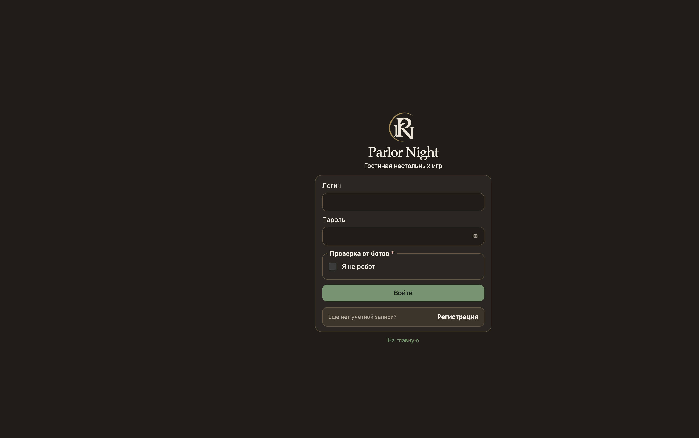

A guest signs in with a username and a password. Before «Войти» the page asks for a human check: the browser solves a small proof-of-work, and the person only ticks the box.

A username is lowercase Latin letters, digits, `_`, and `-`, usually 3 to 32 characters. The password follows the rules the administrator set for this parlor. The sign-in page and the settings page show the current sentence, such as a minimum length, a letter, and a digit. A wrong password gets the same general sentence as an unknown username. After several failures sign-in closes for a while.

Registration has three modes:

| Mode | Who can create an account |
| --- | --- |
| Closed | Only an administrator, on the Guests page |
| Referral | A person who opened a live friend link `/?ref=…` |
| Open | Any visitor of the registration page |

A birth date is required. It unlocks poker, blackjack, and Preferans: those three open at 18. If the date is missing or the person is under 18, the parlor shows the reason and leads to settings.

After the first registration the name is still empty. While family name, given name, and patronymic are blank, the site asks the guest to introduce themselves. The table and the chats show whatever is filled in. An empty form leaves the username.

While `ENV=local`, startup creates the accounts `admin` / `admin` and `user` / `user`. Change those passwords before the parlor faces a network.

## Home

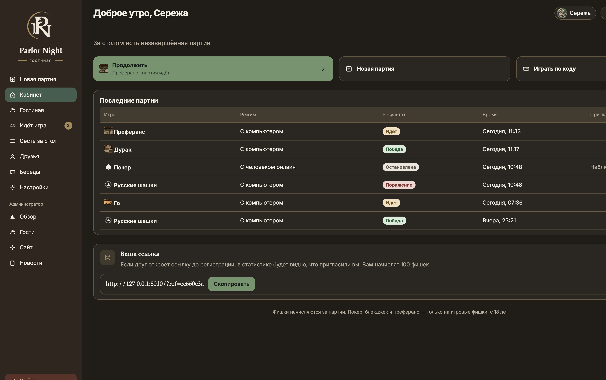

Home is the first page after sign-in. It holds the greeting, an unfinished game, recent tables, and a personal invitation link.

Continue opens the game that can still be played. The recent list shows the game, the mode, the result, and the time. A mode is against the computer, online against a person, a free board, analysis, or a lesson. A result is in progress, win, loss, draw, or stopped.

A link shaped like `/?ref=…` lives on Home and in Settings. If someone opens it before registering, the inviter is remembered and receives chips. The parlor sets the amount; the screenshot shows 100 chips.

The chip count in the header opens the ledger.

## A new game

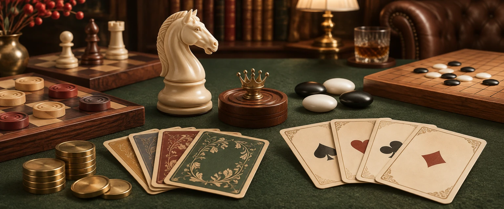

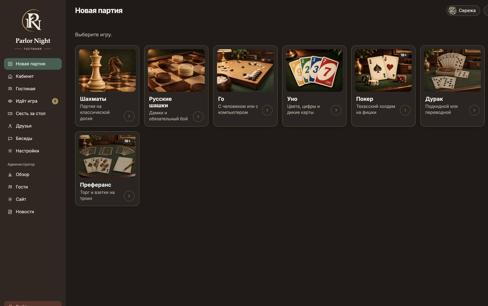

The catalog offers eight games. Poker, blackjack, and Preferans carry an 18+ mark. If a game is switched off in the site settings, its card does not lead to a table.

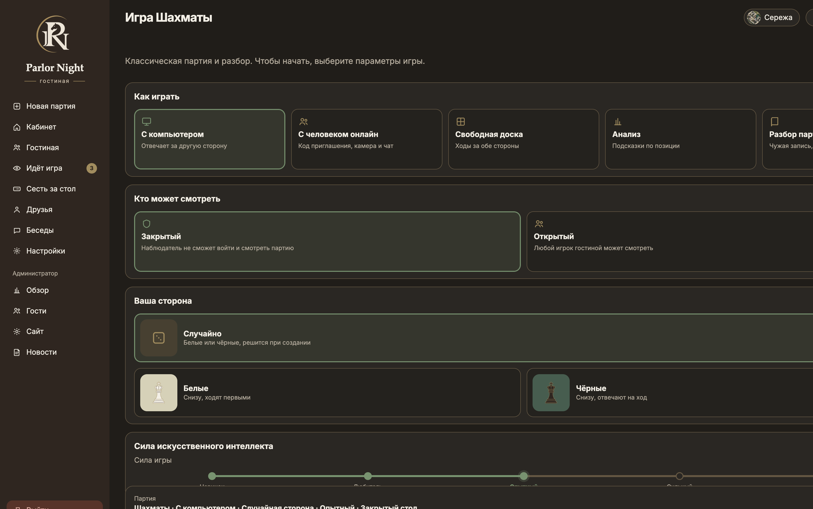

The chosen game's page sets the conditions.

How to play:

| Mode | Meaning |
| --- | --- |
| Against the computer | The parlor's search plays the other side. For chess that search is Stockfish |
| Online against a person | An 8-character code appears. The second player sits through «Сесть за стол» or the link |
| Free board | Chess and checkers only. Moves for both sides |
| Analysis | Chess and checkers only. Position hints, for an administrator |
| Lesson | Chess and checkers only. Paste a record and step through it |

Who may watch:

- A closed table appears in the live list, but sitting and watching require the code.
- An open table can be watched by any signed-in guest. A watcher does not move and does not join the call.

Side: random, white, or black. In chess and checkers white moves first and sits at the bottom by default. In Go black moves first.

Computer strength has five steps: beginner, amateur, experienced, strong, master. For a chess or checkers lesson you can set a starting position: FEN or PGN for chess, RCP and a move list for checkers.

Card games ask for computers and open seats instead of a side. The creator is already seated. In UNO, poker, and Durak there are one to five seats besides the creator, six at the table in all. In blackjack the dealer plays the house, and the other seats are players at the same table, five at most. Preferans is always three: you and two more. If a seat is waiting for a person, the table waits and issues a code. If no seat is open, the computer plays.

## Games

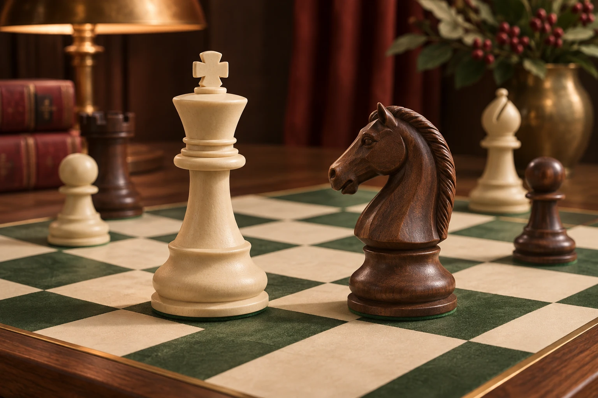

**Chess.** A classical game. A move is a tap on a piece and a square, or a drag. From the keyboard: arrows and Enter, Escape clears the selection. A pawn promotion is taken from the move the server already accepts. There is no chess clock: a dropped connection does not award the game. The record downloads as PGN.

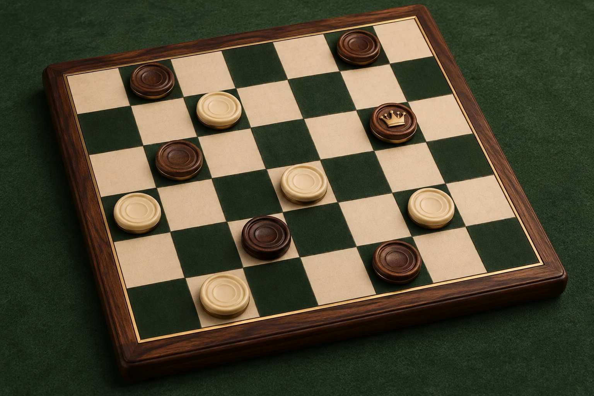

**Russian checkers.** An 8×8 board, play on the dark squares, a capture is mandatory, kings are included. A man in the record is `M`, a king is `K`. The computer moves with SimpleEngine from py-draughts. The five levels still choose how deep and how long it thinks: a beginner searches less, a master searches longer. When the library does not return a move the rules allow, the parlor's own search plays. A draw is 30 half-moves without a capture and without a man move, plus threefold repetition. The draw rules live in `app/checkers/draws.py`. Threefold repetition is applied by the game rules after a move, outside the search. The record downloads as text.

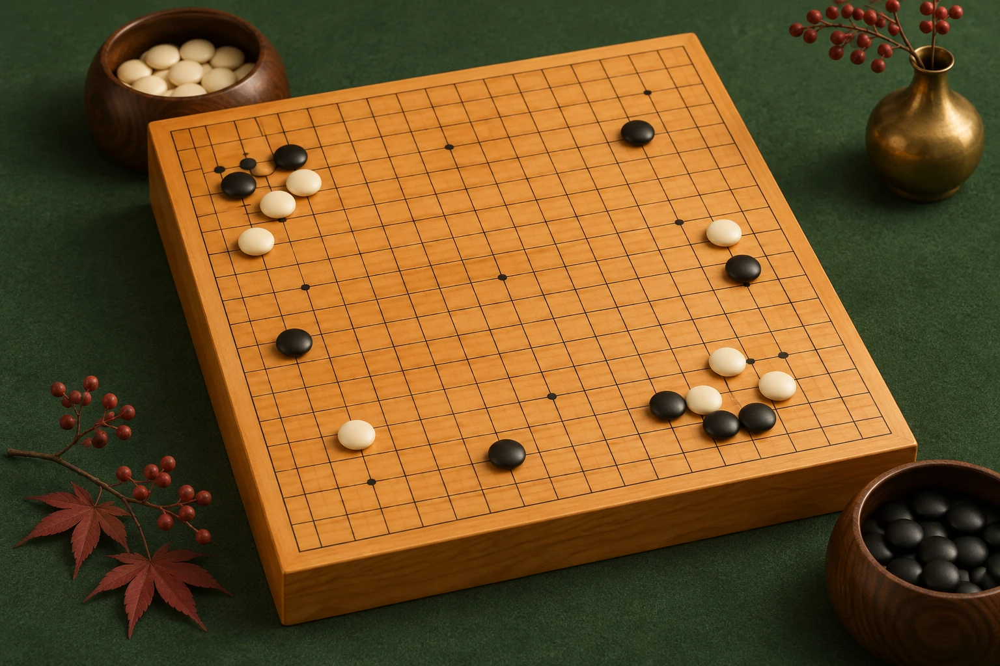

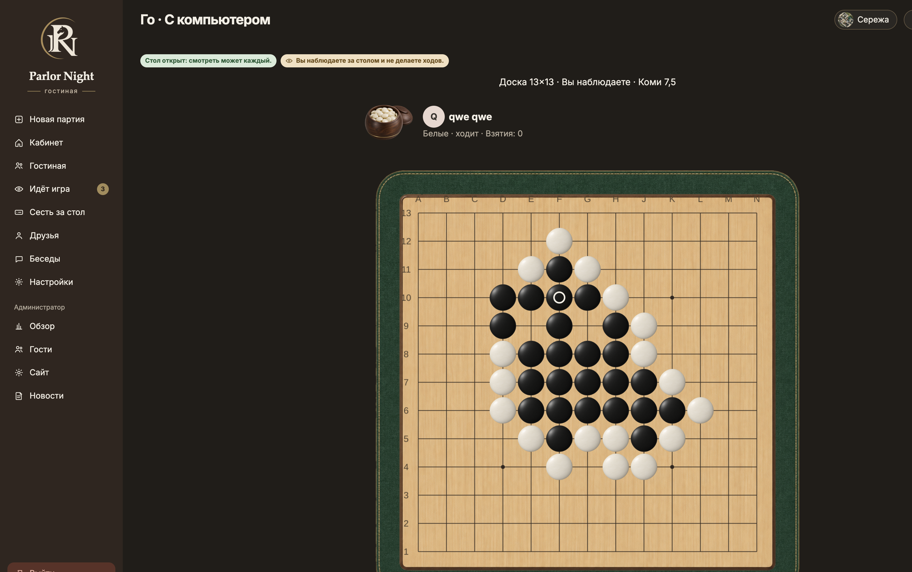

**Go.** Only against a person or the computer. Boards are 9×9, 13×13, and 19×19. Scoring is by area, komi is 7.5. The computer is the parlor's own search with the same five levels as checkers; it is not a professional Go program. There is no clock. After two passes, scoring begins: dead groups are marked, and both players agree to the score or return to play. The record downloads as SGF. The screenshot is an open 13×13 table: the watcher sees the board and a note that they do not move.

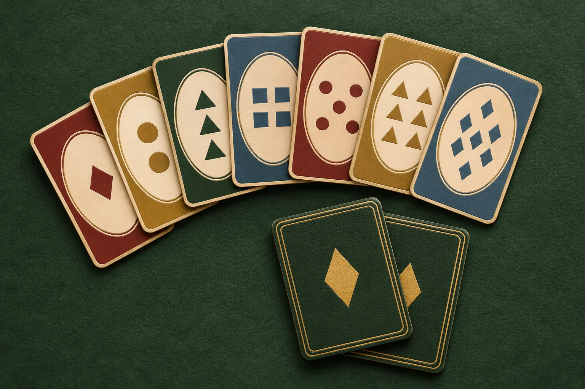

**UNO.** Colors, numbers, and wild cards, up to six players. No money. When one card remains, it is called UNO. Open seats are taken with the code or with Sit when the table is open.

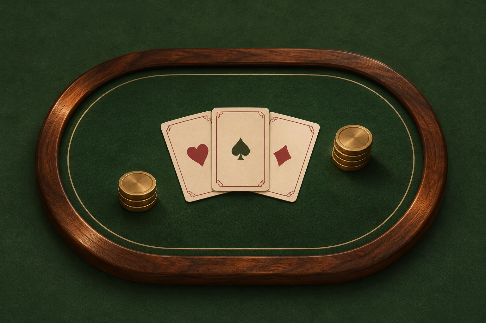

**Poker.** No-limit Texas Hold'em for up to six players, on play chips, from age 18. A hand already started without a full stack is finished under the previous limit. The pot is parlor chips. If fewer than two seats can still afford the game, the table is done and a rematch is not offered.

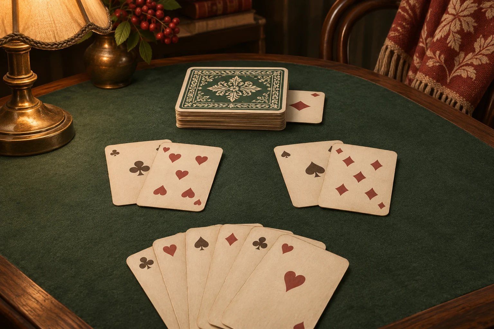

**Durak.** Podkidnoy or perevodnoy, chosen before the first card. A 36-card deck, from the six. Up to six players. In perevodnoy an unbeaten card of the same rank can be passed on. When two or more computers sit with you and no other person is at the table, Leave offers to watch the rest, finish it at once, or stay. Watch gives your seat to a computer, and the others play on one card at a time, so each throw and each beat stays visible. Finish at once plays the table out without a pause and opens the summary. A single computer still ends the game at once.

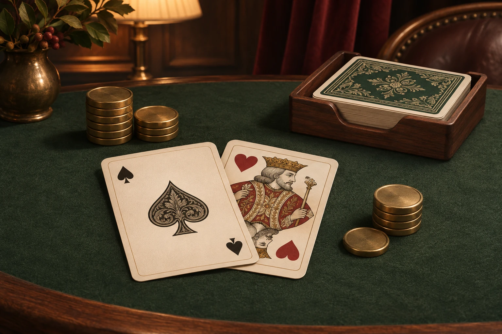

**Blackjack.** Against the dealer, on play chips, from age 18. The dealer plays the house. The other seats are players at the same table. A bet, then hit, stand, or double when the move allows it. The dealer's second card stays hidden until the showdown.

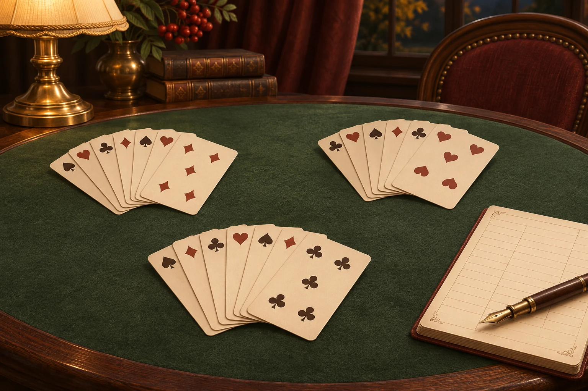

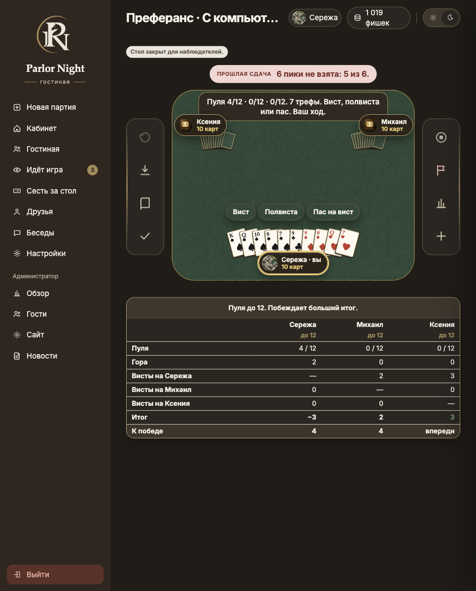

**Preferans.** Three players, bidding, whist, and tricks, from age 18. The pool is chosen at creation: 6, 10, 12, 16, or 20 points, or another number from 6 to 20. The price of a point is chosen then too: 1, 2, 5, or 10 chips. Everyone sits with a stack of 100 points at the chosen price: 100 chips at price 1, 200 at 2, 500 at 5, and 1,000 at 10. Only that stack leaves the account; the rest stays for other games. If the account has less than the stack, the game does not start: there is no play on credit. Stopping the game returns the stack. Chips stay put while the pool is open. When it closes, the score sheet turns the difference into chips, and never more than the stack. If the sheet is larger than the stack, it shows how much did not move. Nothing beyond the stack is taken from the account. This is not a tournament pool. A whist is answered with whist, half-whist, or pass. Beside the player who made the contract, a counter shows how many tricks are already taken out of the order, for example "2 of 6". It sits to the right of the upper-left and the bottom cards, and to the left of the upper-right card. On a miser it shows how many tricks are already taken, with the word miser. Under the table are the bullet, the mountain, the whists, and the chips.

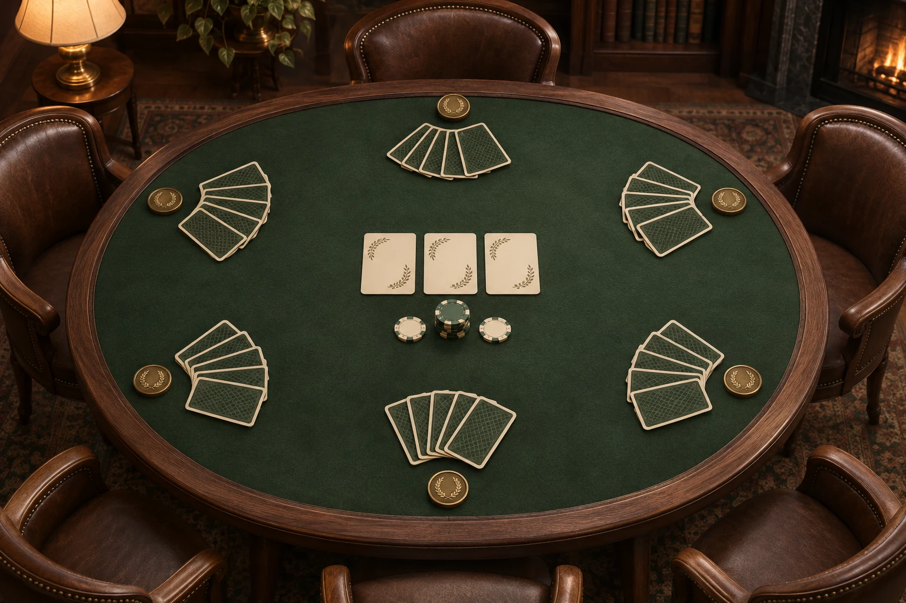

UNO, poker, and Durak seat several people and computers at one table. Blackjack seats players against the dealer. Preferans is always three.

## At the table

A game refreshes on its own, about once every second and a half. There is no socket for moves. The table socket is only for video and voice of the people who are seated.

Above the board the page says whose turn it is, whether the table is open, and whether you may move. The buttons depend on the game: undo exists for chess and checkers, flip changes who sits at the bottom, and save lifts the game into Continue. The creator can stop the table. A player can resign a started game. A watcher does not get those buttons.

A card travels to the table along an arc, slower than a straight toss, and turns a little on the way. A checker or a chess piece hops over the squares and settles on its own. When a card trick or a beaten bout is complete, the cards stay on the table for about two and a half seconds. The button "В бито" beside them clears them earlier. While they stay, the computers do not start the next bout.

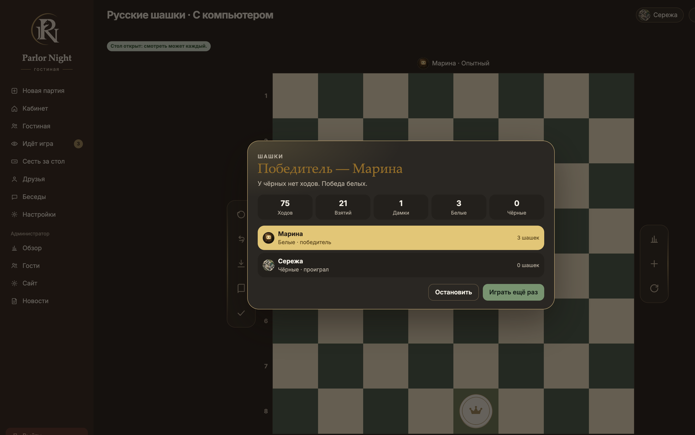

When a game ends, a summary opens: the result sentence, moves, captures, and who won. Play again offers a rematch. Against the computer the new game starts at once. Against a person the rematch waits for both. A draw and a stopped board have no rematch. Card games still have one after a stop, until a poker table has chips left for only one seat.

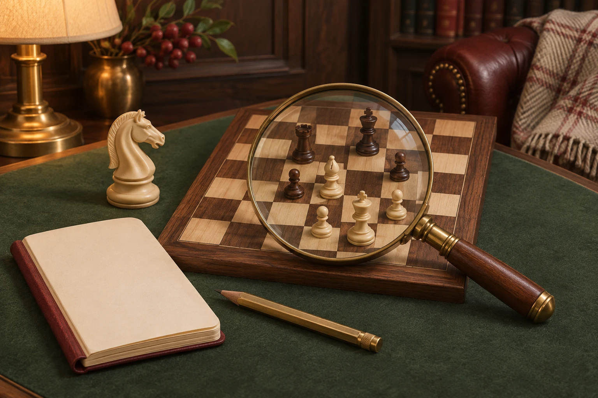

Analysis and the hint belong to an administrator. A guest plays, reads the move list, and downloads the record. Go has no computer hint.

A person can be invited from a table that is still waiting: the username goes to a private chat together with the code.

## The lobby and live tables

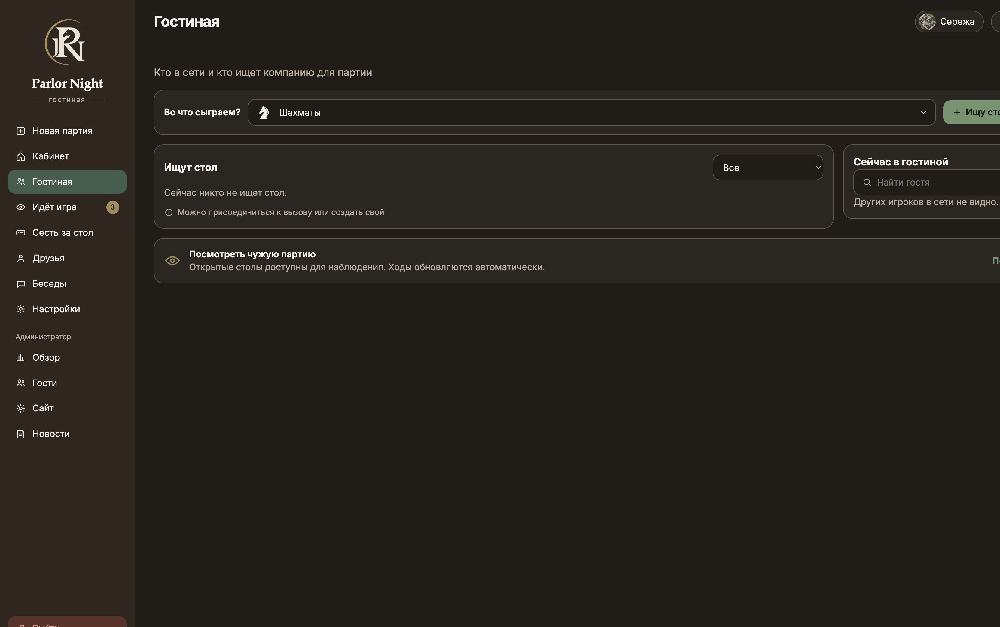

The lobby shows who has been looking for company for the last 15 minutes and who was online in the last 2 minutes. Your own seek is a game and a seat count. A new seek replaces the old one. Someone else's seek is accepted with a button and seats both of you at a new table. You cannot accept your own seek. Under 18, adult games are hidden from this list.


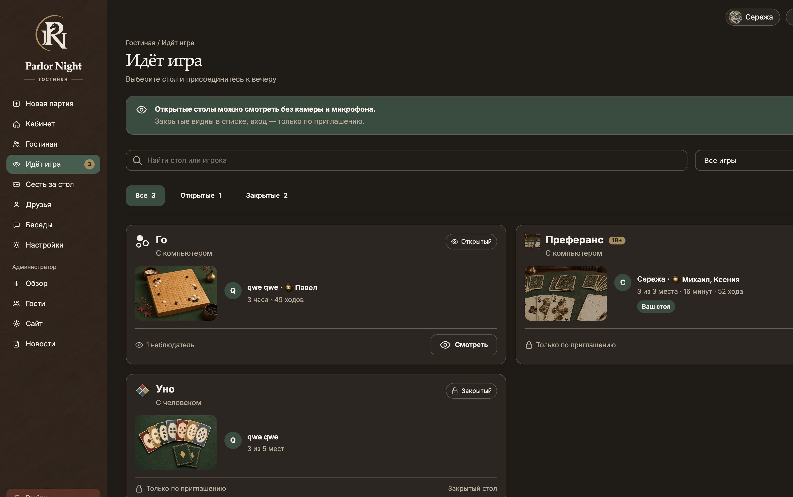

Live tables are games that already exist. The list refreshes itself. An open table can be watched without a camera or a microphone and, if a seat is free, sat at. A closed table is visible in the list, and entry requires the invitation. The filter splits tables into all, open, and closed. Search looks for a table or a player.

Sit at a table accepts an 8-character code. The same code seats a player and, for an open game, admits a watcher.

## Friends and chats

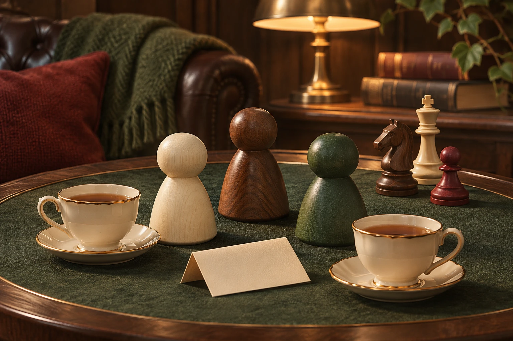

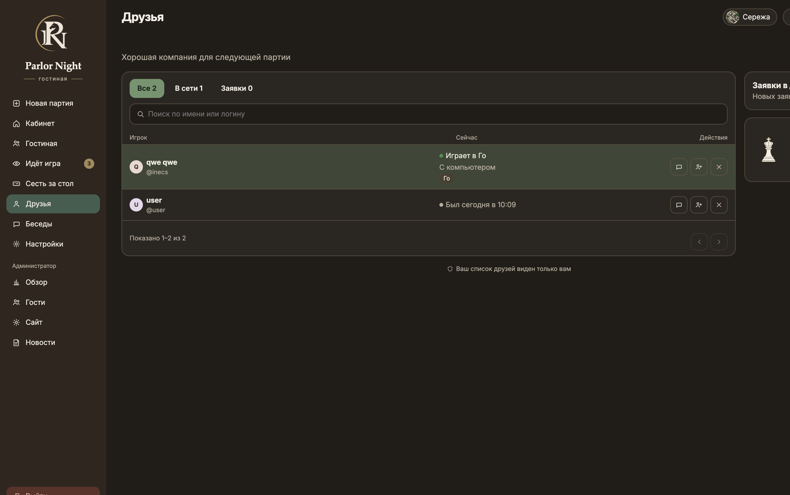

Friends are added by username. A request waits for consent. Only the recipient can accept it. Declining removes both a request and an accepted friendship. The list is visible only to you.

A friend shows whether they are online and which game they are in. Write opens a private chat. Invite creates a table of the chosen game and sends the code into the chat. An invitation in the text can be accepted: the code leads to the seat.

Chats are stored on the server. A message is 1 to 1000 characters. Opening a thread marks it read. The bell in the header gathers up to six fresh messages and friend requests. There is no phone push: the site and the app ask whether anything is new. On a tablet the thread keeps the same space under it as on a large screen.

The table chat is a different thread. Seated players and watchers of an open game can see it. It keeps the latest 80 lines.

## Chips

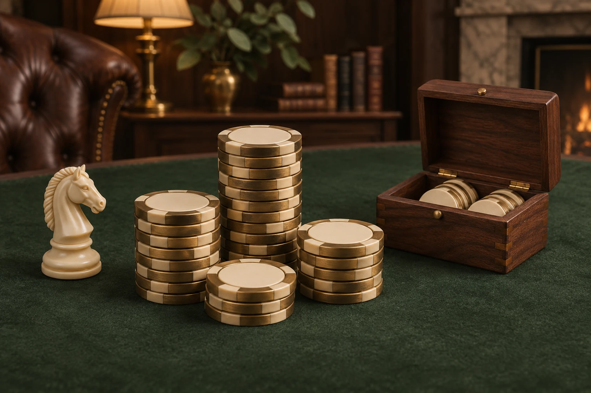

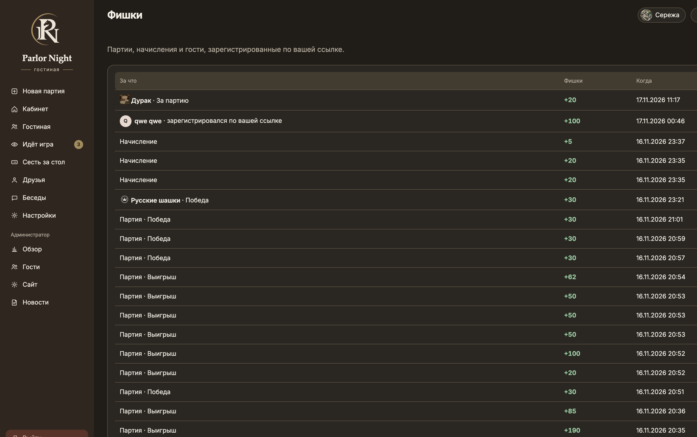

Chips are for play. A win and a draw award them. A loss does not take a separate penalty. Poker, blackjack, and Preferans play a pot of these chips. A friend who arrives through the link awards chips to the inviter. An administrator can add chips to a guest.

The ledger distinguishes a game, an invitation, and a manual grant. A row leads to the table or to the person's profile when those are known.

A player profile shows the name, portrait, presence, chips, friendship, and statistics: played, wins, losses, draws, a breakdown by game, and eight weeks. The chart on the site is drawn from those numbers.

## Settings


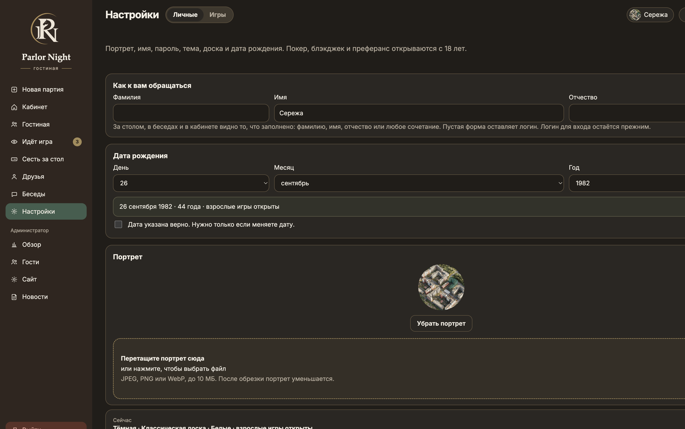

The Personal tab:

- family name, given name, and patronymic;
- birth date, with a confirmation when the date changes;
- portrait: JPEG, PNG, or WebP up to 10 MB, cropped on the page, and a smaller picture is what the server stores;
- password: current, new, and repeat, under the parlor's rules;
- theme: follow the system, light, or dark. The sun and moon in the header change the theme at once;
- the invitation link.

The Games tab: board style (classic or contrast), default side and default game, chess analysis depth, and checkers strength. Poker, blackjack, and Preferans are stored as the default game only from age 18.

Changing the password on the website revokes app tokens. Changing the password in the app keeps the current token chain and revokes the other sign-ins, including the website.

## News


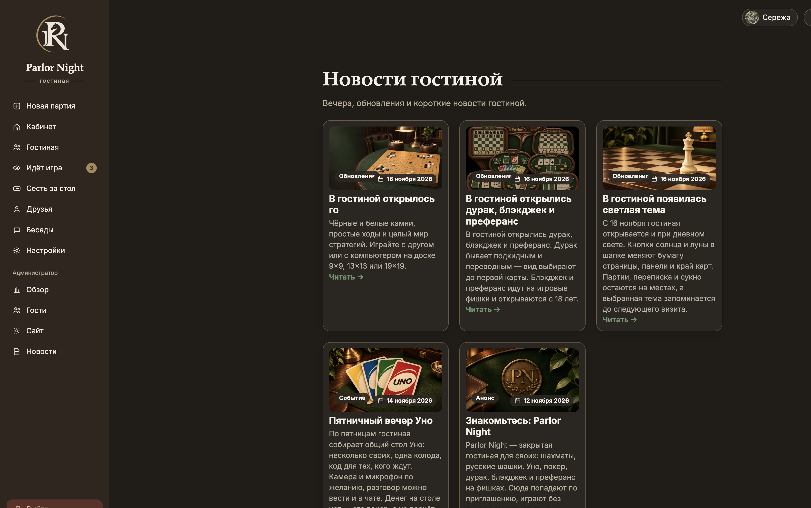

News can be read without signing in. A card has a short note, a date, a kind (update, event, announcement), and a cover. If the cover is a file, the picture lives on its own. Otherwise it is a built-in parlor cover. The body is already sanitized HTML.

Rules, privacy, and contact are separate site pages: `/rules`, `/privacy`, `/contact`.

## Video and voice


Camera and microphone are buttons on the game page. Play works without them. A call holds up to six players seated at one online table. Watchers are outside that limit: they watch the game and do not send sound or video. The streams go between browsers. On the public parlor, a closed direct path receives TURN and the stream goes through it. A local start without `TURN_HOST` keeps only a public STUN server. There is no mixer that folds everyone into one picture.

## Administrator

An administrator has four pages in the sidebar.

| Page | Purpose |
| --- | --- |
| Overview | A summary of games. Clearing records asks for confirmation |
| Guests | A new account, role, activation, and chips. A deactivated guest loses sessions and app tokens |
| Site | Registration mode, password rules, session lifetime, which games are open, and the banner |
| News | Creating, editing, covering, and deleting posts |

Closing other website sessions also revokes app tokens.

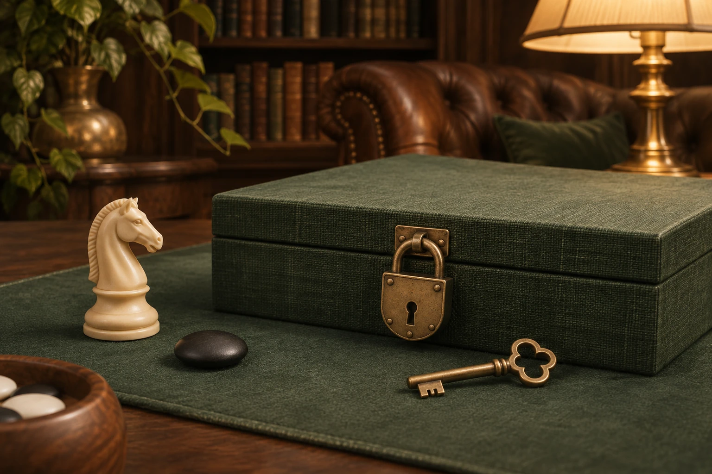

The parlor is meant for a known circle. Self-service registration is off by default. Portraits are served only to someone who is signed in. The friend list is visible only to its owner. A closed table does not admit a watcher without the code.

## Running it

```bash
cp .env.example .env
make up
```

The address is `http://127.0.0.1` and the port from `WEB_PORT`. The sample environment uses 8000. Useful commands: `make down`, `make logs`, `make migrate`, `make test`, `make lint`, `make backup`.

Checks without Docker need Python 3.12: `make install`, then `make test`. Integration tests skip themselves when PostgreSQL at `TEST_DATABASE_URL` is down. `make backup` writes a dump into `backups/`.

`SECRET_KEY` is longer than 32 characters. The sample in `.env.example` is fit only for `ENV=local`. The database, the chess engine, cookies, trusted hosts, registration, `ENGINE_MODE`, and `TURN_*` are described there. One web process runs inside a pod. The cluster runs two such pods, and a separate pod calculates chess, checkers, and Go. Valkey carries the call signal between pods. Card games stay in the site pod. Games and sessions stay in PostgreSQL, so sign-out and an expired session take effect at once. Valkey also holds request counters, failed sign-ins, and the "player is here" marks.

The site and the database currently listen only on the local address. If the parlor is opened to the internet, it needs a filter at the network entrance.

A new game is added in `app/catalog.py`: a title and a rules module that deals, checks a move, and shows a player only their own cards. An adult game is marked with `adult`.

## Limits

- An online game has no chess clock and no automatic award when the connection drops.
- Threefold repetition in checkers is applied by the game rules after a move. The computer is SimpleEngine from py-draughts, and the five levels still set depth and time. When the library does not return a legal move, the parlor's own search plays.
- Go does not claim the strength of a professional program.
- The call has no mixer for every participant: a stream is either direct or relayed through TURN. A network that allows only port 443 does not get a relay.
- Lc0 and other networks are not included: they need weights and often a GPU. Any local UCI engine can be set in `CHESS_ENGINE_PATH`.
- The parlor does not push notifications to a phone.

## For an app developer

A mobile app signs in with the same username and password, receives a token pair, and then sends `Authorization: Bearer`. Registration, home, friends, the lobby, chats, news, chips, and all eight games are available as JSON. Video is a separate socket of the same table.

The full contract, error codes, and table fields: [API in English](api.md) and [API на русском](../mobile-api.md).
