# Parlor Night


Parlor Night — закрытая гостиная настольных игр. За одним вечером здесь собираются шахматы, русские шашки, го, Уно, техасский холдем, дурак, блэкджек и преферанс. Игра идёт на фишки. Денег в гостиной нет.

Шахматы считает Stockfish. Шашки и го считает собственный поиск гостиной. Во время партии не нужны внешние API и телеметрия. Картинка и голос идут между браузерами. Сервер знакомит участников одного стола и, когда прямой путь закрыт, отдаёт им TURN.

Это руководство описывает сайт так, как им пользуются гости. Контракт для мобильного приложения — в [описании API](../mobile-api.md). English: [Parlor guide](../en/guide.md).

Художественные картинки ниже передают атмосферу разделов. Расклад фигур и карт на них не является учебным разбором партии. Снимки экрана — живой интерфейс гостиной.

## Вход

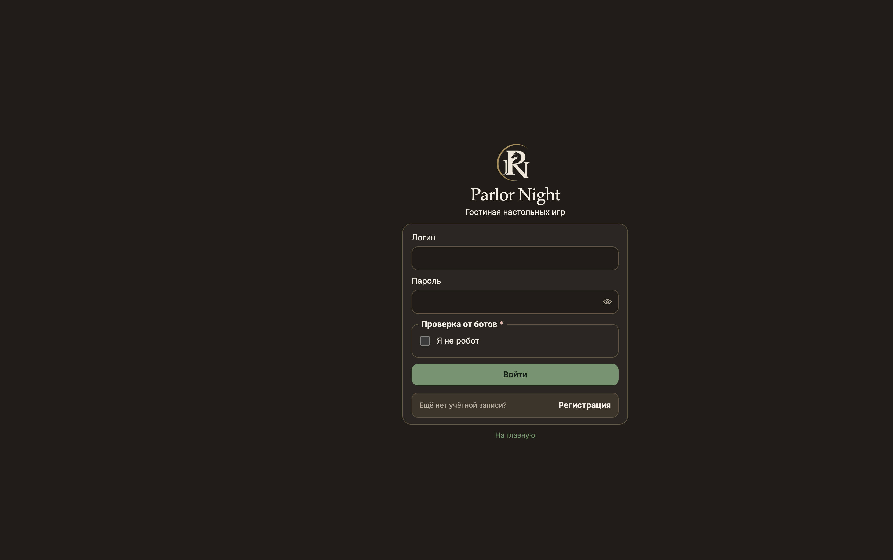

Гость входит логином и паролем. Перед кнопкой «Войти» страница просит решить проверку «Я не робот»: браузер подбирает число к заданию, человек только отмечает поле.

Логин — строчные латинские буквы, цифры, `_` и `-`, обычно от 3 до 32 символов. Пароль подчиняется правилам, которые администратор задал для гостиной: на странице входа и в настройках написана актуальная фраза, например минимальная длина, буква и цифра. Неверный пароль отвечает той же общей фразой, что и неизвестный логин. После нескольких неудач вход на время закрывается.

Регистрация бывает в трёх режимах:

| Режим | Кто может создать учётную запись |
| --- | --- |
| Закрыта | Только администратор, на странице «Гости» |
| По ссылке | Человек, который открыл живую ссылку друга `/?ref=…` |
| Открыта | Любой посетитель страницы «Регистрация» |

Дата рождения обязательна. По ней открываются покер, блэкджек и преферанс: эти три игры доступны с 18 лет. Если даты нет или человеку меньше 18, гостиная показывает причину и ведёт в настройки.

После первой регистрации имя ещё не задано. Пока фамилия, имя и отчество пусты, сайт просит представиться. За столом и в беседах видно то, что заполнено. Пустая форма оставляет логин.

Пока `ENV=local`, при старте создаются входы `admin` / `admin` и `user` / `user`. Для сети эти пароли нужно сменить.

## Кабинет

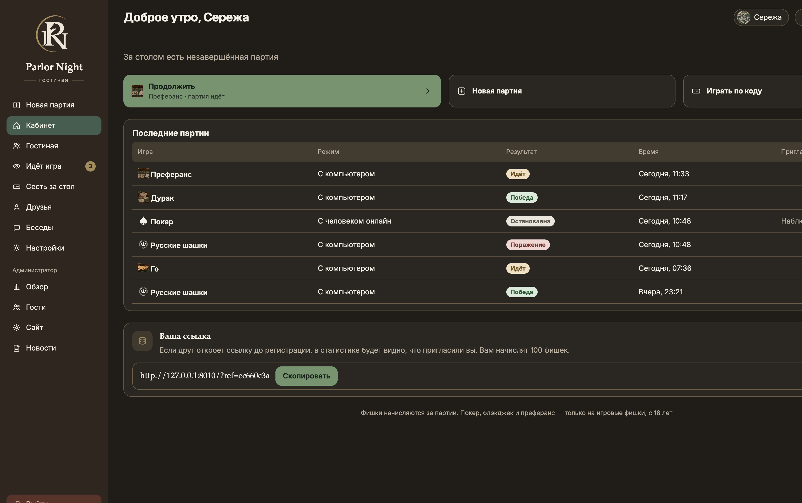

Кабинет — первая страница после входа. Здесь приветствие, незавершённая партия, последние столы и личная ссылка приглашения.

«Продолжить» открывает партию, которую ещё можно играть. В списке последних столов видны игра, режим, результат и время. Режим бывает «с компьютером», «с человеком онлайн», свободная доска, анализ или разбор. Результат — идёт, победа, поражение, ничья или остановлена.

Ссылка вида `/?ref=…` живёт в кабинете и в настройках. Если человек откроет её до регистрации, в статистике будет видно, кто пригласил, и пригласившему начислят фишки. Размер начисления задаёт гостиная; на снимке это 100 фишек.

Фишки в шапке ведут в историю начислений.

## Новая партия

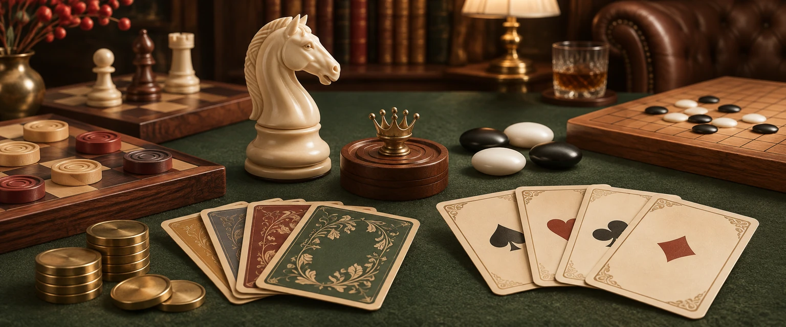

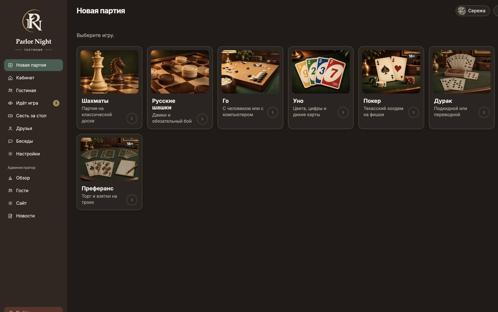

Каталог предлагает восемь игр. У покера, блэкджека и преферанса стоит метка 18+. Если игра выключена в настройках сайта, её карточка в каталоге не ведёт за стол.

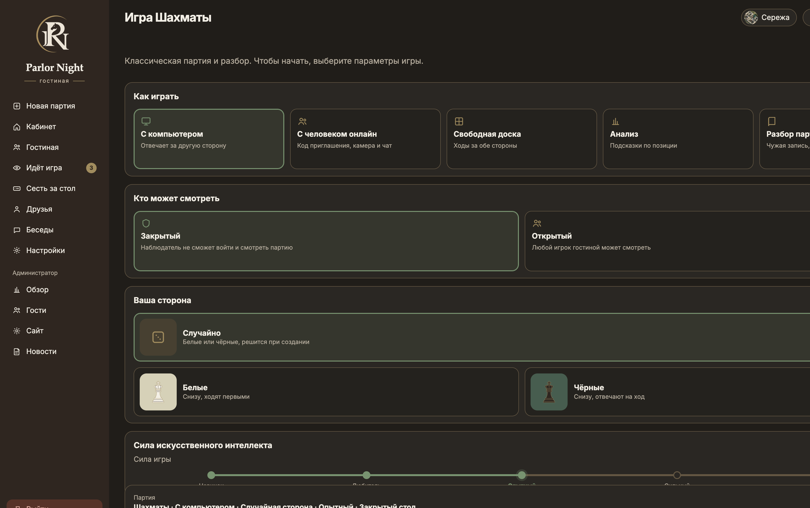

На странице выбранной игры задаются условия.

Как играть:

| Режим | Смысл |
| --- | --- |
| С компьютером | Другую сторону ведёт поиск гостиной. У шахмат это Stockfish |
| С человеком онлайн | Появляется код из 8 символов. Второй игрок садится через «Сесть за стол» или по ссылке |
| Свободная доска | Только шахматы и шашки. Ходы за обе стороны |
| Анализ | Только шахматы и шашки. Подсказки по позиции, для администратора |
| Разбор партии | Только шахматы и шашки. Можно вставить свою запись и идти ход за ходом |

Кто может смотреть:

- Закрытый стол виден в списке живых столов, но сесть и смотреть можно только по коду.
- Открытый стол может смотреть любой вошедший гость. Наблюдатель ходов не делает и в видеосвязь не входит.

Сторона: случайно, белые или чёрные. Белые в шахматах и шашках ходят первыми и по умолчанию сидят снизу. В го чёрные ходят первыми.

Сила компьютера — пять ступеней: новичок, любитель, опытный, сильный, мастер. Для шахматного и шашечного разбора можно задать стартовую позицию: FEN или PGN у шахмат, RCP и список ходов у шашек.

У карт вместо стороны задаются компьютеры и свободные места. Создатель уже сидит. В уно, покере и дураке кроме него от одного до пяти мест, всего не больше шести. В блэкджеке дилер играет за дом, другие места — игроки за тем же столом, их не больше пяти. В преферансе всегда трое: вы и ещё двое. Если есть свободное место для человека, стол ждёт и выдаёт код. Если свободных мест нет, играет компьютер.

## Игры


**Шахматы.** Классическая партия. Ход — касание фигуры и поля или перетаскивание. С клавиатуры — стрелки и Enter, Escape снимает выбор. Превращение пешки выбирается из хода, который сервер считает законным. Шахматных часов нет: оборвавшаяся связь партию не присуждает. Запись скачивается как PGN.

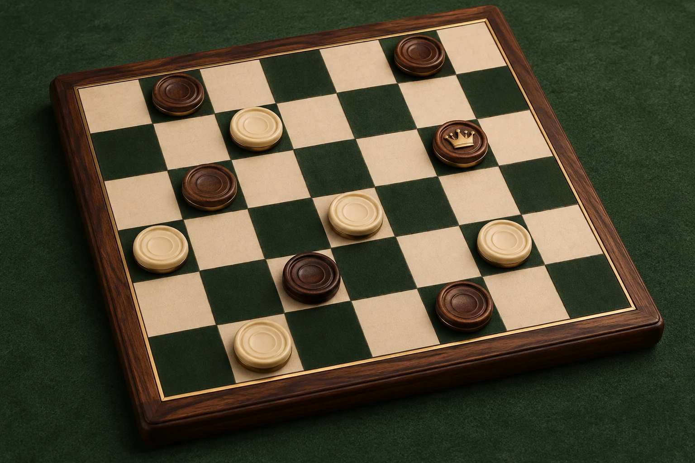

**Русские шашки.** Доска 8×8, игра по тёмным полям, обязательное взятие, дамки. Простая шашка в записи — `M`, дамка — `K`. Ничья: 30 полуходов без взятия и без хода простой шашки, плюс троекратное повторение. Подробности правил ничьей лежат в `app/checkers/draws.py`. Шашечный поиск не считает троекратное повторение внутри перебора. Запись скачивается текстом.

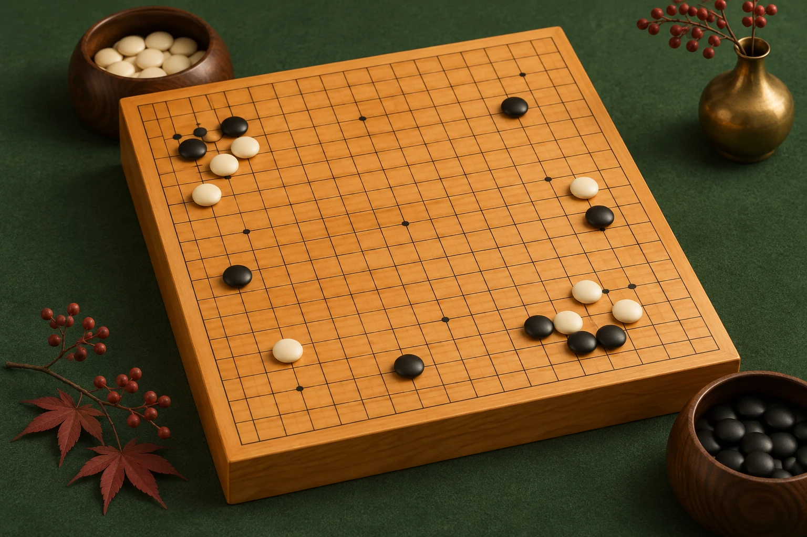

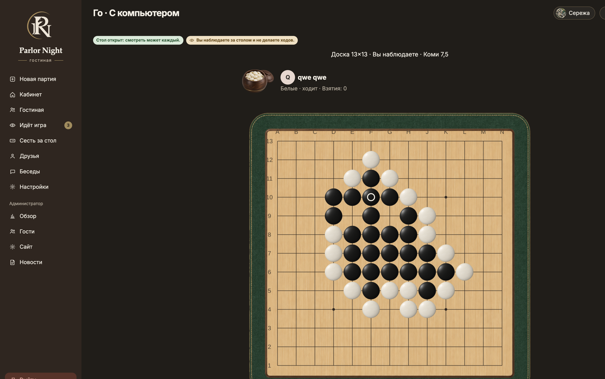

**Го.** Только с человеком или с компьютером. Доски 9×9, 13×13 и 19×19. Подсчёт по площади, коми 7,5. Компьютер — собственный поиск с теми же пятью уровнями, что у шашек; это не профессиональная программа го. Часов нет. После двух пасов начинается подсчёт: мёртвые группы помечаются, оба игрока соглашаются со счётом или возвращаются к игре. Запись скачивается как SGF. На снимке открытый стол 13×13: наблюдатель видит доску и подпись, что ходов он не делает.

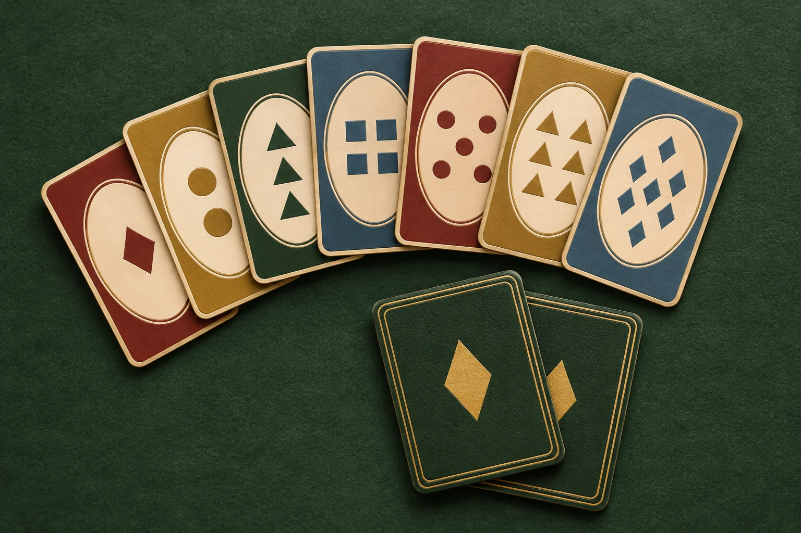

**Уно.** Цвета, цифры и дикие карты, до шести игроков. Денег нет. Когда на руке остаётся одна карта, её объявляют «Уно». Свободные места занимают по коду или кнопкой «Сесть», если стол открыт.

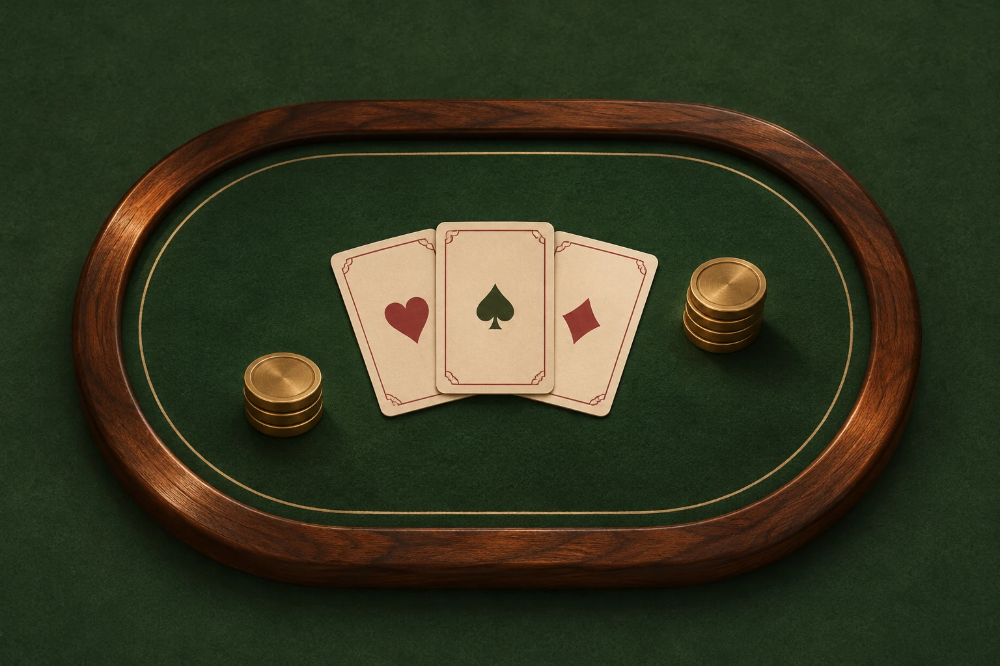

**Покер.** Безлимитный техасский холдем до шести игроков, на игровые фишки, с 18 лет. Уже начатая раздача без стека доигрывается прежним лимитом. Банк — фишки гостиной. Если после раздачи фишек хватает меньше чем у двоих, стол закончен и реванш не предлагается.

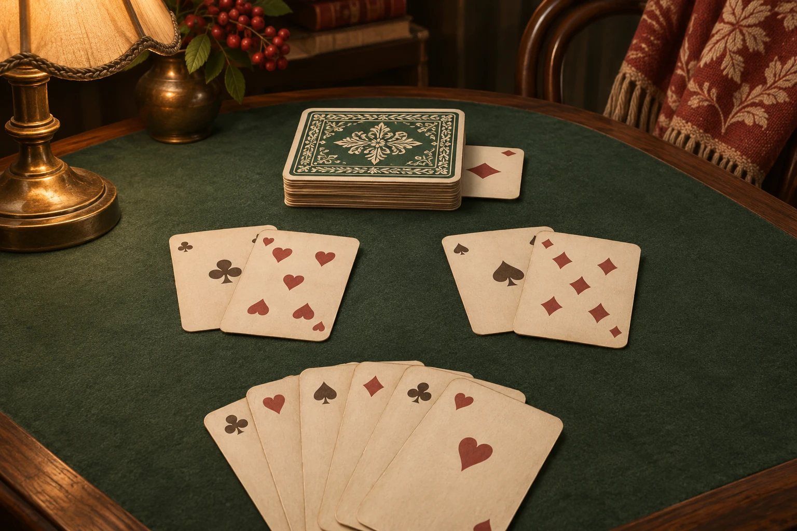

**Дурак.** Подкидной или переводной, вид выбирается до первой карты. Колода в 36 карт, с шестёрки. До шести игроков. В переводном небитую карту одного достоинства можно перевести дальше.

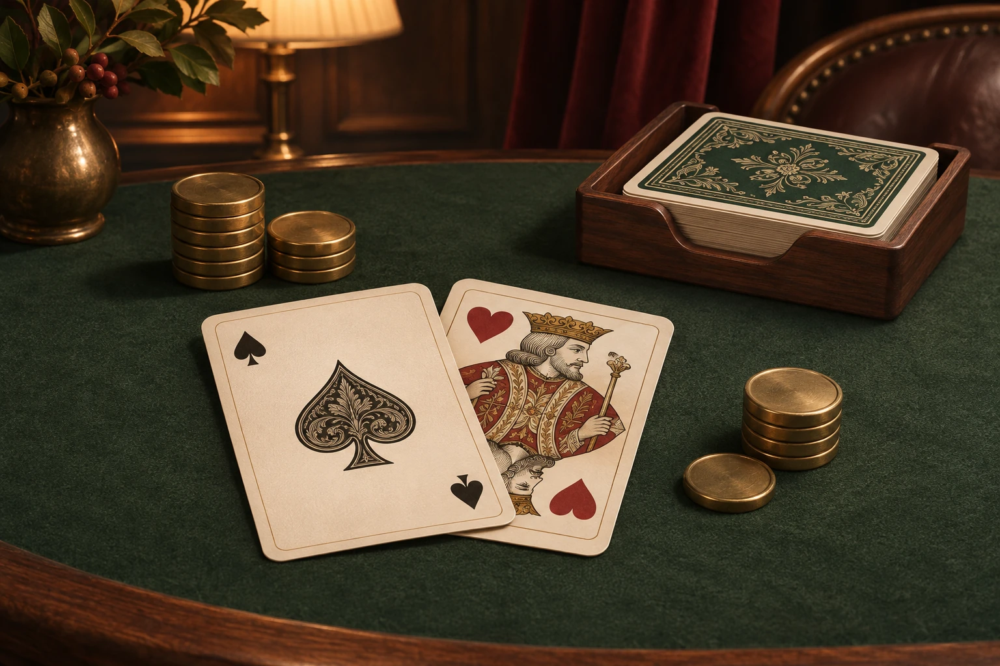

**Блэкджек.** Против дилера на игровые фишки, с 18 лет. Дилер играет за дом. Другие места — игроки за тем же столом. Ставка, затем «ещё», «хватит» или «удвоить», когда ход это позволяет. Вторая карта дилера закрыта, пока раздача не дошла до вскрытия.

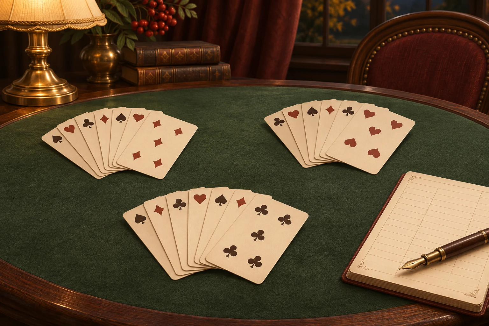

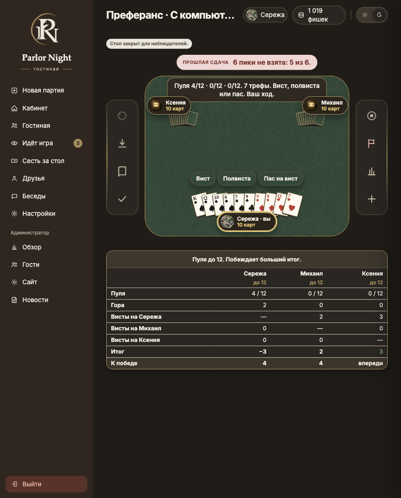

**Преферанс.** Трое игроков, торг, вист и взятки, с 18 лет. Пуля задаётся при создании: 6, 10, 12, 16 или 20 очков, либо другое число от 6 до 20. Цена очка тоже выбирается до первой сдачи: 1, 2, 5 или 10 фишек. На стол садится стек в 100 очков по выбранной цене: при цене 1 это 100 фишек, при цене 2 — 200, при цене 5 — 500, при цене 10 — 1 000. Со счёта списывается только он, остальные фишки остаются для других игр. Если на счёте меньше стека, партия не начинается: в долг здесь не играют. Остановка возвращает стек на счёт. Пока пуля открыта, фишки лежат на месте. Когда она закрыта, расписка переводит разницу итогов в фишки, но не больше стека. Если расписка больше стека, в пуле видно, сколько не перешло. Со счёта сверх стека ничего не списывается. Это не турнирная пуля. На вист отвечают «вист», «полвиста» или «пас». Внизу стола — пуля, гора, висты и фишки.

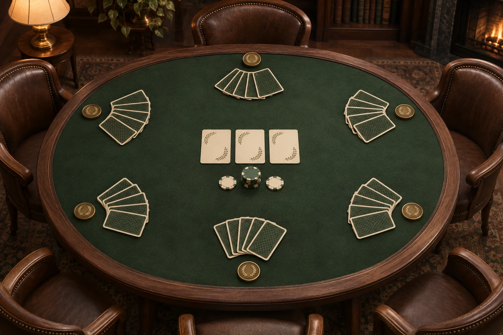

Уно, покер и дурак собирают несколько человек и компьютеров за одним столом. Блэкджек сажает игроков против дилера. Преферанс всегда на троих.

## За столом

Партия обновляется сама, примерно раз в полторы секунды. Отдельного сокета для ходов нет. Сокет стола нужен только видео и голосу тех, кто сидит.

Над доской написано, чей ход, открыт ли стол и можно ли сейчас ходить. Кнопки зависят от партии: отменить ход есть у шахмат и шашек, повернуть доску меняет, кто снизу, сохранить поднимает партию в «продолжить». Создатель может остановить стол. Игрок может сдаться в начатой партии. Наблюдатель этих кнопок не получает.

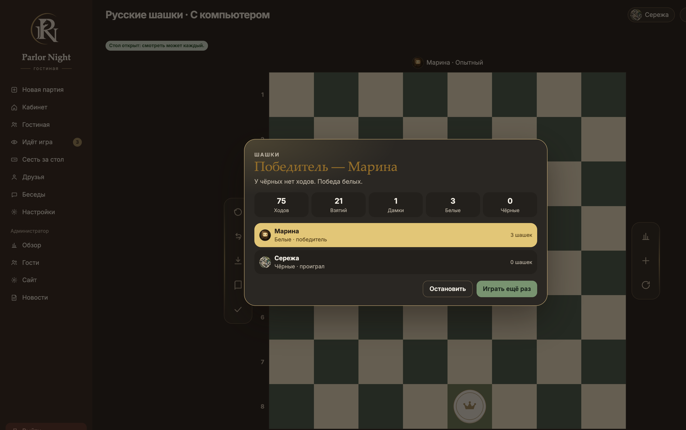

Когда партия кончается, открывается окно итога: фраза результата, ходы, взятия и кто победил. «Играть ещё раз» предлагает реванш. Против компьютера новая партия начинается сразу. С человеком реванш ждёт согласия обоих. У ничьей и остановленной доски реванша нет. У карт он есть и после остановки, пока за покерным столом фишки не остались у одного.


Анализ и подсказка доступны администратору. Обычный гость играет, смотрит журнал ходов и скачивает запись. В го подсказок компьютера нет.

Пригласить человека можно с ещё не начатого стола: логин уходит в личную беседу вместе с кодом.

## Гостиная и живые столы

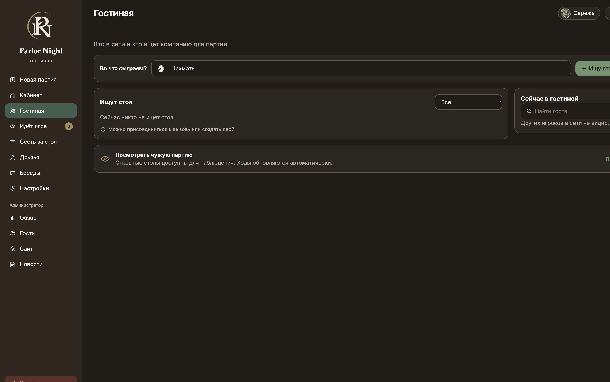

Гостиная показывает, кто ищет компанию последние 15 минут и кто был в сети последние 2 минуты. Свой вызов — игра и число мест. Новая заявка заменяет старую. Чужой вызов принимается кнопкой и сажает обоих за новый стол. Свою заявку принять нельзя. До 18 лет взрослые игры в этом списке скрыты.


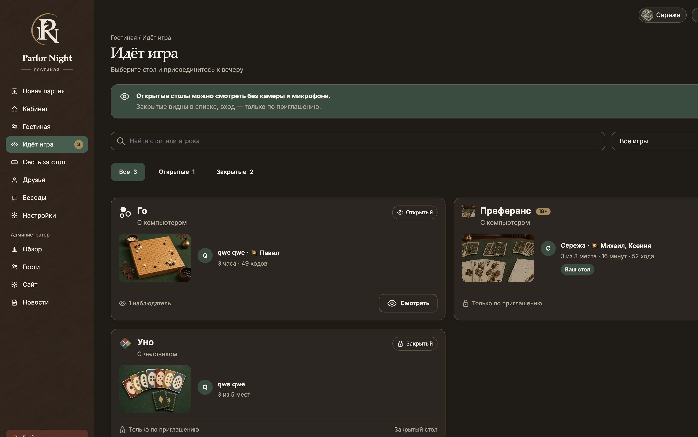

«Идёт игра» — столы, которые уже созданы. Список сам обновляется. Открытый стол можно смотреть без камеры и микрофона и, если есть место, сесть. Закрытый стол виден в списке, а войти можно только по приглашению. Фильтр делит столы на все, открытые и закрытые. Поиск ищет стол или игрока.

«Сесть за стол» принимает код из 8 символов. Тот же код сажает игрока и, для открытой партии, пускает наблюдателя.

## Друзья и беседы

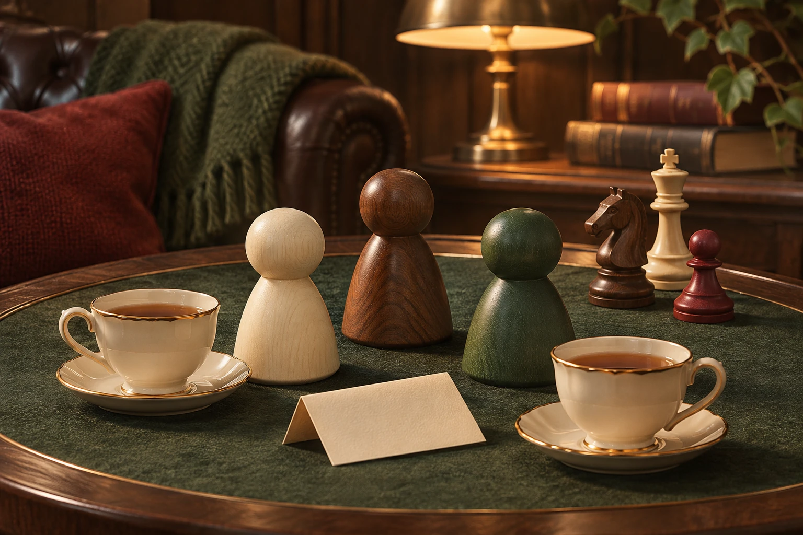

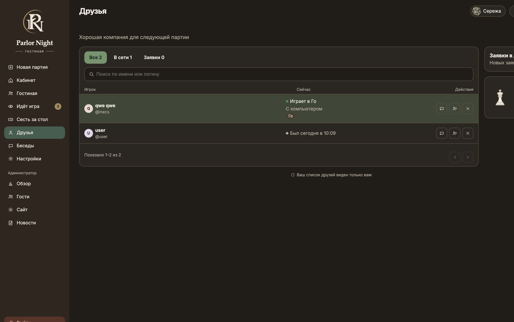

Друзей добавляют по логину. Заявка ждёт согласия. Принять её может только адресат. Отклонение снимает и заявку, и уже принятую дружбу. Список виден только вам.

У друга видно, в сети ли он и за какой игрой сидит. «Написать» открывает личную беседу. «Позвать» создаёт стол выбранной игры и отправляет код в беседу. Приглашение в тексте можно принять: код ведёт на посадку за стол.

Беседы хранятся на сервере. Сообщение — от 1 до 1000 символов. Открытый диалог помечается прочитанным. Колокольчик в шапке собирает до шести свежих сообщений и заявок в друзья. Отдельных уведомлений на телефон нет: сайт и приложение сами спрашивают, есть ли новое.

Чат за столом — другая переписка. Его видят сидящие и наблюдатели открытой партии. В нём до 80 последних реплик.

## Фишки


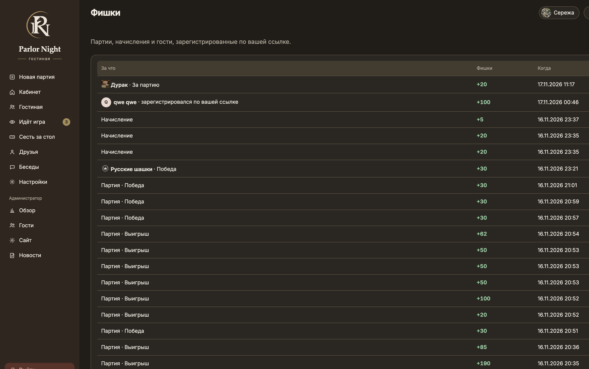

Фишки игровые. Победа и ничья их начисляют, проигрыш не отнимает отдельным штрафом. Покер, блэкджек и преферанс играют банком из этих фишек. Друг, пришедший по ссылке, даёт пригласившему начисление. Администратор может дописать фишки гостю.

История различает партию, приглашение и ручное начисление. Строка ведёт к столу или к профилю человека, если они известны.

Профиль игрока показывает имя, портрет, присутствие, фишки, состояние дружбы и статистику: сыграно, победы, поражения, ничьи, разбивку по играм и восемь недель. График на сайте рисуется из этих чисел.

## Настройки


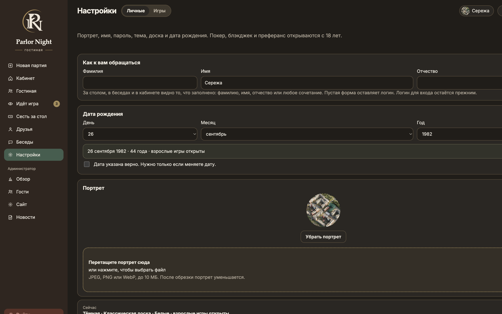

Вкладка «Личные»:

- фамилия, имя и отчество;
- дата рождения, с подтверждением, если дату меняют;
- портрет: JPEG, PNG или WebP до 10 МБ, обрезка на странице, на сервер уходит уменьшенный снимок;
- пароль: старый, новый и повтор, по правилам гостиной;
- тема: как в системе, светлая или тёмная. Кнопки солнца и луны в шапке меняют тему сразу;
- ссылка приглашения.

Вкладка «Игры»: вид доски (классическая или контрастная), сторона и игра по умолчанию, глубина шахматного разбора и сила шашечного. Покер, блэкджек и преферанс в качестве игры по умолчанию сохраняются только с 18 лет.

Смена пароля на сайте гасит входы приложений. Смена пароля в приложении оставляет текущую цепочку токенов и гасит остальные входы, включая сайт.

## Новости


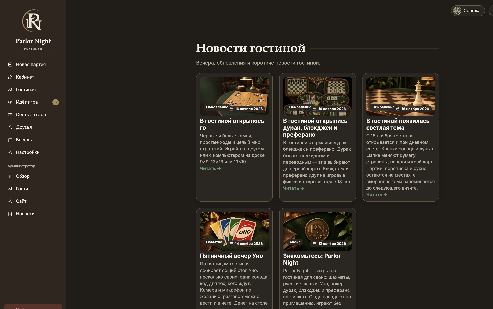

Новости читаются без входа. В ленте короткая заметка, дата, вид (обновление, событие, анонс) и обложка. Если обложка — файл, картинка лежит отдельно. Иначе это готовая обложка гостиной. Текст новости — уже очищенный HTML.

Правила, конфиденциальность и контакты — отдельные страницы сайта: `/rules`, `/privacy`, `/contact`.

## Видео и голос


Камера и микрофон включаются кнопками на странице партии. Играть можно и без них. В созвоне до шести игроков, которые сидят за одним онлайн-столом. Наблюдатели в этот предел не входят: они смотрят партию и не передают звук и видео. Потоки идут между браузерами. На публичной гостиной, если прямой путь закрыт, браузер получает TURN и поток идёт через него. Локальный запуск без `TURN_HOST` оставляет только публичный STUN. Микшера, который собирает всех в одну картинку, нет.

## Администратор

В боковой колонке у администратора четыре страницы.

| Страница | Зачем |
| --- | --- |
| Обзор | Сводка партий. Очистка записей просит подтверждение |
| Гости | Новая учётная запись, роль, включение и выключение, фишки. Выключенный гость теряет сессии и токены приложений |
| Сайт | Режим регистрации, правила пароля, срок сессии, какие игры открыты, объявление на страницах |
| Новости | Создание, правка, обложка и удаление заметок |

Закрытие чужих сессий на сайте гасит и токены приложений.


Гостиная рассчитана на своих. Самостоятельная регистрация по умолчанию выключена. Портреты отдаются только вошедшему. Список друзей виден только владельцу. Закрытый стол не пускает наблюдателя без кода.

## Запуск

```bash
cp .env.example .env
make up
```

Адрес — `http://127.0.0.1` и порт из `WEB_PORT`. В примере окружения это 8000. Полезные команды: `make down`, `make logs`, `make migrate`, `make test`, `make lint`, `make backup`.

Для проверок без Docker нужен Python 3.12: `make install`, затем `make test`. Интеграционные тесты пропускаются, если PostgreSQL по `TEST_DATABASE_URL` недоступен. `make backup` кладёт дамп в `backups/`.

`SECRET_KEY` длиннее 32 символов. Пример из `.env.example` годится только для `ENV=local`. База, шахматный движок, куки, доверенные хосты, регистрация, `ENGINE_MODE` и `TURN_*` описаны там же. Внутри пода веб-процесс один. В кластере таких подов два, а шахматы, шашки и го считает отдельный под. Сигнал созвона между подами несёт Valkey. Карточные партии остаются в поде сайта. Партии и сессии лежат в PostgreSQL, поэтому выход и просроченная сессия действуют сразу. Valkey также держит счётчики запросов, неудачных входов и отметки «игрок на месте».

Сейчас сайт и база слушают только локальный адрес. Если гостиную откроют в интернет, перед ней нужен фильтр на входе сети.

Новая игра добавляется в `app/catalog.py`: название и модуль правил, который сдаёт колоду, проверяет ход и показывает игроку только его карты. Взрослая игра помечается флагом `adult`.

## Ограничения

- В онлайн-партии нет шахматных часов и автоматического присуждения при обрыве связи.
- Шашечный движок не считает троекратное повторение внутри перебора.
- Го не претендует на силу профессиональной программы.
- В созвоне нет микшера на всех участников: поток либо прямой, либо через TURN. Сеть с одним открытым портом 443 реле не получает.
- Lc0 и другие сети сюда не входят: для них нужны веса и часто видеокарта. Любой локальный UCI-движок можно указать в `CHESS_ENGINE_PATH`.
- Уведомления на телефон не отправляются.

## Для разработчика приложения

Мобильное приложение входит теми же логином и паролем, получает пару токенов и дальше ходит с заголовком `Authorization: Bearer`. Регистрация, кабинет, друзья, гостиная, беседы, новости, фишки и все восемь игр доступны через JSON. Видео — отдельный сокет того же стола.

Полный контракт, коды ошибок и поля стола: [API на русском](../mobile-api.md) и [API in English](../en/api.md).
